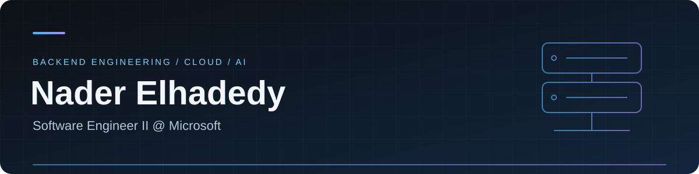
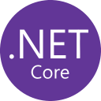

  

  
  
  

  Building cloud services and APIs — from design to production. 
  <strong>Python &amp; C# · Azure &amp; AWS · Based in Egypt</strong>

## 👋 A little about me

- 💼 **Software Engineer II at Microsoft**, working on backend services for search and AI grounding on Azure.
- 🛠️ I own features end-to-end: design, implementation, testing, delivery, and production support.
- ☁️ Previously built AWS data-processing services at **Trufla** and a FastAPI booking platform at **Gostada**.
- 🧠 AI/ML postgraduate diploma holder, currently studying **Agentic AI at Udacity**.
- 🏓 Away from the keyboard, you'll find me playing table tennis.

## 🧰 Tech stack

<strong>Languages &amp; backend</strong>

  
  
  
  
  

<strong>Cloud &amp; engineering</strong>

  
  
  
  
  
  

<strong>Databases</strong>

  
  
  
  

## 📊 GitHub at a glance

  

  

These cards reflect public GitHub activity; professional work may live in private repositories.

---

  <strong>Let's connect.</strong> 
  Always happy to talk backend engineering, cloud services, and AI.  
  <a href="https://www.linkedin.com/in/nader-elhadedy">LinkedIn</a> · <a href="mailto:nader.m.elhadedy@gmail.com">Email</a>

